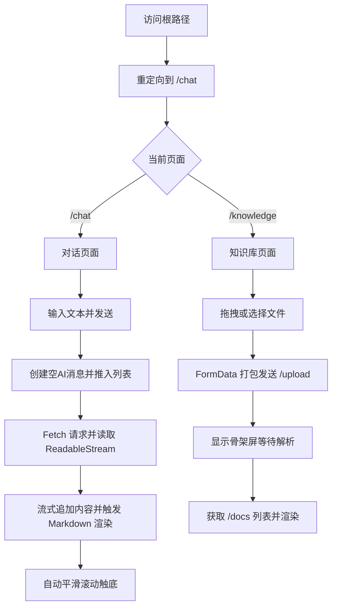

## 1. 产品概述
构建一个名为“Second Brain”的前端应用，基于 Vue3 + TypeScript 构建，提供对话工作台与知识库管理功能。
- 主要解决用户与 AI 进行流式对话交互，以及上传 Markdown 知识库文档的需求。
- 为 RAG（检索增强生成）系统提供现代化的前端用户界面。

## 2. 核心功能

### 2.1 功能模块
1. **全局布局 (App Shell)**：左侧导航栏 + 右侧内容区域。
2. **对话工作台 (Chat)**：消息列表展示（支持 Markdown 渲染和代码高亮），底部固定输入区，流式打字机效果。
3. **知识库管理 (Knowledge)**：文档拖拽上传，文档资产列表渲染，上传与解析状态展示。

### 2.2 页面详情
| 页面名称 | 模块名称 | 功能描述 |
|-----------|-------------|---------------------|
| ChatView | 消息列表 | 展示对话记录，支持 Markdown 渲染，代码高亮，气泡平滑推移，自动滚动触底 |
| ChatView | 输入区 | 固定在底部，支持用户输入并发送消息 |
| KnowledgeView | 拖拽上传区 | 虚线边框，支持拖拽文件或点击唤起文件选择器上传 Markdown 文件 |
| KnowledgeView | 文档列表 | 网格或列表展示已入库的文档信息，包含加载中/解析中的骨架屏状态 |

## 3. 核心流程
用户可以通过左侧导航在对话和知识库之间切换。在对话页面，用户发送消息，前端通过 Fetch 接收流式响应并实时渲染 Markdown。在知识库页面，用户拖拽上传文档，前端调用上传接口并刷新文档列表。

## 4. 用户界面设计
### 4.1 设计风格
- 整体风格：极客质感，现代化极简风格。
- 主色调：深色模式 (Dark Mode) 为主，或者深浅色自适应。左侧导航栏采用深色背景。
- 排版：使用 `@tailwindcss/typography` (`prose prose-slate dark:prose-invert`) 优化 Markdown 排版。
- 代码高亮：引入 `highlight.js` 的暗黑主题（如 Atom One Dark 或 GitHub Dark）。
- 动效：使用 `@formkit/auto-animate` 实现消息气泡平滑推移。

### 4.2 页面设计概览
| 页面名称 | 模块名称 | UI 元素 |
|-----------|-------------|-------------|
| 布局 (Layout) | 侧边栏 | 深色背景，固定宽度，激活状态高亮显示 |
| 布局 (Layout) | 主内容区 | 占据剩余空间，弹性布局 |
| ChatView | 消息列表 | `flex-col`, 滚动条，Markdown 渲染组件，自动动画指令 |
| ChatView | 输入框 | 固定底部，全宽输入框，发送按钮 |
| KnowledgeView | 上传区 | 虚线边框，拖拽提示图标与文字 |
| KnowledgeView | 资产列表 | Grid 或 Flex 布局的文档卡片，骨架屏 (Skeleton) |

### 4.3 响应式设计
- 桌面端优先，主推“左侧导航 + 右侧内容”的经典布局。
