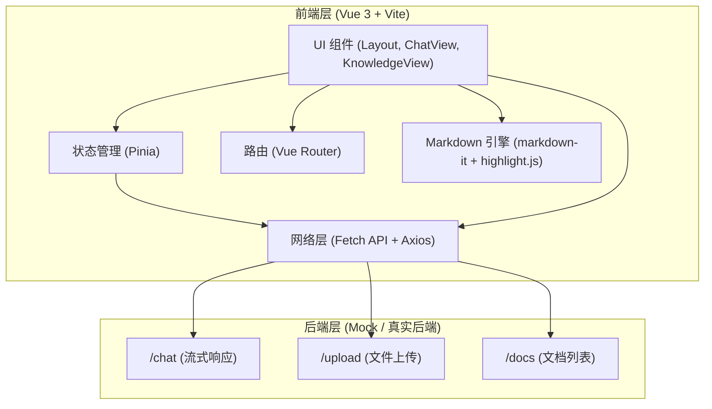

## 1. 架构设计


## 2. 技术栈说明
- **前端框架**: Vue 3 (Composition API) + TypeScript
- **构建工具**: Vite
- **路由**: vue-router
- **状态管理**: pinia
- **CSS 框架**: Tailwind CSS
- **排版插件**: @tailwindcss/typography
- **Markdown 渲染**: markdown-it, highlight.js
- **网络请求**: axios (用于普通请求), 原生 Fetch API (用于流式请求)
- **动画引擎**: @formkit/auto-animate

## 3. 路由定义
| 路由路径 | 视图组件 | 用途 |
|-------|---------|---------|
| `/` | - | 默认重定向到 `/chat` |
| `/chat` | `ChatView.vue` | 对话工作台页面 |
| `/knowledge` | `KnowledgeView.vue` | 知识库管理与文档上传页面 |

## 4. API 定义
由于目前仅开发前端，假设以下 API 接口契约：

```typescript
// POST /api/chat
// 请求体: { message: string }
// 响应: text/event-stream 或分块返回的字符串流

// POST /api/upload
// 请求体: FormData (file: File)
// 响应: { success: boolean, id: string, message: string }

// GET /api/docs
// 响应: { data: Array<{ id: string, name: string, status: 'parsing' | 'ready', createdAt: string }> }
```

## 5. 核心组件结构
- `src/App.vue`: 挂载 `RouterView`
- `src/components/Layout.vue`: 全局 App Shell 布局
- `src/views/ChatView.vue`: 对话视图
- `src/views/KnowledgeView.vue`: 知识库视图
- `src/components/MarkdownRenderer.vue`: 纯手工 Markdown 渲染器组件
- `src/api/chat.ts`: 封装 Fetch 流式请求
- `src/store/chatStore.ts`: Pinia store，管理对话状态
